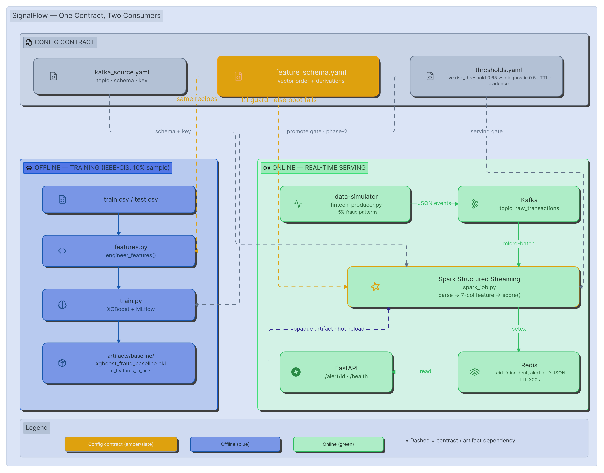

# SignalFlow — Real-Time Fraud Serving with a Config-Driven Train/Serve Contract



A streaming pipeline that watches live transaction events, scores each one for fraud in
real time, and writes a **structured, explainable alert** to Redis for the decision layer
to read. Stack: Kafka (KRaft) → Spark Structured Streaming → XGBoost (opaque, hot-reloaded
artifact) → Redis → FastAPI. Offline training tracked with MLflow.

> **The deliverable is not a fraud model. It is a method for shipping AI that does not lie
> to itself.** Most production AI fails silently — the same-named feature computed one way
> at train time and another at serve time. SignalFlow makes that divergence *structurally
> impossible to hide*: one YAML contract governs both sides, and the stream refuses to boot
> if they disagree.

## The problem it solves
Card-not-present fraud is stopped in seconds or not at all; a nightly batch model reacts
*after* the charge settles, when the money is already gone. That is acute for payment
providers and marketplaces — including in emerging economies — that process real volume
**without a dedicated 24/7 fraud desk**. An automated real-time gate that blocks the obvious
hits and *explains* each flag to a human is the difference between eating a loss and
catching it.

## Why this architecture (the judgment, not the tutorial)
- **Kafka in KRaft mode** (no ZooKeeper): one fewer component to operate; the trade-off is
  managing `CLUSTER_ID` by hand — accepted for a simpler bootstrap.
- **Spark Structured Streaming, not Flink**: the workload is near-real-time feature prep in
  small micro-batches. Flink's strict event-time/low-latency would be overkill here; I'd
  migrate only if p99 latency or stateful windowing became a hard requirement.
- **Redis, not Cassandra**: the access pattern is a single-key, ms-latency lookup of an
  alert by transaction id (`tx:{id} → incident_id`, plus the full `alert:{incident}`
  payload, TTL 300s = the human review window). Cassandra re-enters only if we need wide,
  distributed, high-write-volume feature storage.
- **The feature contract lives in YAML, not code.** `feature_schema.yaml` declares the
  vector order *and* the derivation of every column. Both the offline trainer and the
  online stream read it, and the stream refuses to boot if the two disagree (the 1:1
  guard). This is the whole point: a hand-written pipeline can silently compute
  `hour_of_day` one way at train time and another at serve time. A config contract makes
  that divergence impossible to hide.

## The contract, in one map
| Config file | Controls | Offline consumer | Online consumer | Invariant it enforces |
|---|---|---|---|---|
| `kafka_source.yaml` | topic, bootstrap, offsets, key_field, event schema | — (simulator matches) | `spark_job.py` | stream subscribes the topic the producer writes; key = Redis lookup id |
| `feature_schema.yaml` | vector order + per-column derivation | `features.py` (train) | `spark_job.py` (serve) | `derivations` covers `feature_columns` 1:1, same order — else **boot fails** |
| `thresholds.yaml` | risk threshold, TTL, min-amount, cooldown, evidence, labels | `evaluations/` (gate) | `spark_job.py` (gate) | one tuning knob, zero code edits; dangling evidence keys skipped defensively |
| `training_pipeline.yaml` | data path, split, subsample, promotion gates | `train.py` | **never** | the stream must not see training config — that's the seam |
| `hyperparams.yaml` | XGBoost params | `train.py` | **never** | same |
| `registry/` + `pointer.json` | which approved version is live, its type, frozen maps | `promote.py` (phase-2) | `ArtifactLoader` (hot-reload) | stream only loads what the gate approved; opaque blob behind `score()` |

Read the right two columns together and the purpose leaps out: **offline and online never
hand-write a feature again.** The skew this project hunts (real group-bys offline vs
constants online; relative `TransactionDT` vs a real clock; per-call `cat.codes` vs a
frozen map) becomes impossible to conceal, because there is exactly one place a feature's
meaning lives, and two consumers forced to agree with it or die at startup.

## Results — and the price of honesty
Trained on a 10% subsample of IEEE-CIS Fraud Detection (Kaggle, public): 47,243 train /
11,811 test rows, ~3.6% fraud. The committed artifact is the **7-column** model
(`n_features_in_ = 7`):

| Metric | 7-col (shipped, honest) | 9-col (earlier, inflated) |
|---|---|---|
| ROC-AUC | 0.732 | 0.777 |
| PR-AUC | 0.118 | 0.180 |
| Precision @ 0.5 | ~9% | ~13% |
| Recall @ 0.5 | ~52% | ~52% |

The 7-col model scores *lower on paper* — and that is the point. The 9-col model bought its
extra offline score with two **velocity** features that are real group-bys at training time
but **constants at serve time** (a 2-second micro-batch cannot see history). So its paper
advantage was a mirage the moment it met production. Dropping velocity trades a few offline
points for true train↔serve parity: every feature the shipped model uses is one the live
stream computes *the same way on both sides*. **I did not ship a feature I could not
compute identically at train and serve time. That refusal is the design.**

Note on thresholds: the table above is measured at the **diagnostic** 0.5 (what
`metadata.json` prints). The **live** serving gate is `risk_threshold: 0.65` in
`thresholds.yaml`, which emits far fewer alerts — the 0.5 false-positive count is not what
the running system produces. Sweeping that threshold to maximize recall under an FP budget
is the phase-2 `evaluations/` gate (the metadata rationale already says it: *"Max recall
within FP limit 5%"*).

## What v1 catches — and what it refuses to fake
The synthetic stream and the IEEE-CIS training set speak slightly different dialects, so v1
ships with **named gaps** rather than silent ones. Serve-time discrimination rides primarily
on `transaction_amt_log`, which reliably fires the **high-amount** pattern; **late-hour**
fires weakly. The rest are documented, each with its exact phase-2 fix:

| Feature | v1 status at serve time | Phase-2 fix |
|---|---|---|
| `user_freq_24h`, `merchant_freq_24h` | **dropped** from the vector | Redis rolling counter (INCR+EXPIRE 86400) + offline retrain on the *same* window |
| `hour_of_day`, `day_of_week` | real clock / ISO calendar | offline derived these from *relative* `TransactionDT`. Fix: simulator emits a relative `transaction_dt`; both sides derive from it |
| `card4_encoded`, `P_emaildomain_encoded` | placeholder 0 | offline used per-call `.cat.codes` (vocabulary-dependent). Fix: freeze the code maps into the artifact `manifest.yaml`; stream looks up the frozen map |
| `is_missing_card2`, `is_missing_dist1` | constant 0 in demo | offline saw real NaNs; the synthetic stream never emits nulls. Fix: inject nulls in the simulator |
| `merchant_id` fraud pattern | **not in the vector at all** | offline "merchant velocity" actually grouped by email domain (a misnomer). Fix: add a real merchant feature + frozen map |

## Trade-offs I accepted
- `startingOffsets=latest` + checkpoint in `/tmp` (not a mounted volume): first-boot events
  emitted before subscribe are dropped, and a restart wipes the offset checkpoint. Fine for
  a demo; in prod I'd persist the checkpoint to a volume and use `earliest` + idempotent
  writes.
- `foreachBatch().toPandas()` collects each micro-batch to the driver: safe for small
  batches, OOM otherwise. Mitigation: push the Redis write into the executor via a connector.
- Per-user cooldown is an in-memory driver dict (v1): not distributed, not restart-safe.
- The demo XGBoost is a *fallback* loaded directly from `artifacts/baseline/` because the
  registry promote-gate (`pointer.json` + `evaluations/`) is phase-2. The serving seam is
  already built for it; the gate is the next offline piece.
- `KEYS` is used for the demo read-path; in production you'd `SCAN` (O(N) vs O(1)).

## What breaks at scale
- Hot Redis keys if one merchant/user floods → key hashing or Redis Cluster.
- `spark.sql.shuffle.partitions=2` is hard-set for the demo volume; wrong for real load.
- A single global `risk_threshold` isn't segmented by merchant category / amount band.

## Reproducibility
```bash
# from repo root
python models/pipelines/train.py          # retrains the 7-col baseline into artifacts/baseline/
bash setup.sh                             # builds images, creates raw_transactions
bash run-spark.sh                         # submits the streaming serving job
curl -s localhost:8000/health
curl -s "localhost:8000/alert/<tx_id from the simulator log>"
```
Tested under WSL2 (Docker Desktop WSL integration). Ports 9092/8080/7077/8000/6379 on
localhost. The committed `.pkl` means the **serving demo runs without the training CSV** —
only retraining needs it (see Data provenance).

## Data provenance
Stream is synthetic, emitted by `data_simulator/fintech_producer.py` to the documented
`kafka_source.yaml` schema (~5% fraud across four patterns). Model trained by
`models/pipelines/train.py` on a 10% subsample of IEEE-CIS Fraud Detection (Kaggle, public),
feature set defined by `feature_schema.yaml`. No PII. **The training CSV is not committed
(size)** — download IEEE-CIS into `models/data/public/` to retrain; the serving path needs
no CSV. In production the simulator is replaced by the real payment gateway; nothing
downstream changes — that swap is the contract's whole job.

## Intentional scaffolds (not oversights)
- `models/pipelines/evaluate.py` and `drift_detector.py` are **empty on purpose** — they are
  the phase-2 promote gate, scaffolded not built.
- `models/registry/` currently holds `active_version.txt` / `versions.csv` while the v1
  loader uses the baseline fallback + `pointer.json`; reconciling them is the phase-2
  promote step.
- `models/artifacts/client/` (v2.1) is the seed of the phase-2 multi-tenant / per-client
  model registry — present, not yet wired.
- The `*.deprecated_*` files (`producer.py.deprecated_rawevents`,
  `tune_threshold.py.deprecated_hardcoded_skew`) are **kept as evidence** of the train/serve
  skew this contract exists to kill — a record of the drift I caught, not clutter.

## Limits & what I cannot conclude
The v1 verdict is calibrated to the simulated + subsampled distribution; it does not
generalize to unseen fraud modes without retrain. Because five of seven serve-time features
are off-distribution or constant (see table), the *reported* risk_score should be read as
"high-amount signal plus noise," not a calibrated probability. Promoting this to a real
decision layer requires the phase-2 parity fixes above and the offline eval gate that
verifies a candidate artifact against the live feature contract before it ever reaches the
stream.